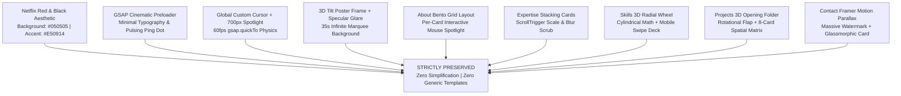

# PORTFOLIO CONTENT BLUEPRINT & IMPLEMENTATION SPECIFICATION

> **Document Version:** 1.0.0  
> **Target Application:** React + Vite Portfolio  
> **Status:** Final Content Blueprint (Implementation Ready)  
> **Visual & Architectural Source of Truth:** Original Netflix-Inspired Crimson & Dark Studio Design

---

## 1. Executive Summary

This blueprint establishes the authoritative content, configuration, and implementation requirements for customizing the developer portfolio for **Kunal Sengar**. 

Every visual asset, transition, 3D perspective effect, GSAP timeline, Framer Motion parallax layer, custom cursor, and interactive geometry from the original application must be strictly preserved. **No redesigning, layout simplification, or theme modifications are permitted.**

---

## 2. Personal Branding & Identity

| Attribute | Specification |
| :--- | :--- |
| **Full Legal & Professional Name** | **KUNAL SENGAR** |
| **Navbar Brand Monogram** | **KS** |
| **Hero Primary Nameplate** | `KUNAL SENGAR` |
| **Primary Professional Role** | `FULL STACK DEVELOPER` |
| **Specialization Headline** | `AI ENGINEER · LLM · RAG` |
| **Official Brand Tagline** | *“Engineering Digital Experiences. Building Intelligent Futures.”* |
| **Primary Location** | Kashipur, Uttarakhand, India |
| **Work Availability** | Available for Freelance & Full-Time Opportunities |
| **Working Language** | English — Professional & International |
| **Primary Action Buttons (Hero)** | 1. `VIEW PROJECTS` (Anchor link to `#projects`) 2. `CONTACT ME` (Anchor link to `#contact`) |

---

## 3. Education

| Detail | Value |
| :--- | :--- |
| **Degree Program** | Bachelor of Technology (B.Tech), 4th Year |
| **Academic Discipline** | Computer Science & Engineering |
| **University / Institution** | Teerthanker Mahaveer University (TMU) |
| **Location** | Moradabad, Uttar Pradesh, India |

---

## 4. Professional Experience

### Current Role: Full Stack Developer
- **Organization / Company:** VibeSoft
- **Position:** Full Stack Developer
- **Start Date:** 7 June 2026
- **Tenure Status:** Ongoing (Present)
- **Description Tone:** Combined professional and technical depth.

#### Core Responsibilities & Scope:
1. **Client Digital Solutions:** Architecting, engineering, and maintaining client-facing responsive websites and scalable web applications.
2. **Full-Stack Development:** Delivering end-to-end frontend interfaces and backend server architecture.
3. **E-Commerce & CMS Platforms:** Custom theme development, template customization, and e-commerce flows on WordPress, WooCommerce, and Shopify.
4. **API & Database Engineering:** Designing secure RESTful APIs, relational/non-relational database models, and third-party service integrations.
5. **Mobile Application Development:** Building cross-platform mobile solutions using Android Studio, Flutter, and Dart.

---

## 5. Technical Skills Matrix

> *Note: In accordance with project rules, skill proficiencies are represented by technological domain without invented percentages or arbitrary ratings.*

### 1. Frontend Engineering
- React.js
- HTML5 & CSS3
- JavaScript (Modern ES6+)
- Tailwind CSS
- Bootstrap
- Responsive & Adaptive Web Design

### 2. Backend Architecture
- Node.js
- Express.js
- REST API Design & Integration
- JWT Authentication & Authorization Pipelines

### 3. CMS & E-Commerce Engineering
- WordPress
- Elementor
- WooCommerce
- Shopify
- Custom Theme Development & Customization

### 4. Database Systems
- MongoDB
- Mongoose ODM
- MySQL
- CRUD Operations
- Relational & Document Schema Design
- Database Indexing & Query Optimization

### 5. Mobile Engineering
- Android Studio
- Flutter
- Dart

### 6. AI & Large Language Models (LLM)
- LLM Integration
- Retrieval-Augmented Generation (RAG)
- LangChain
- LangGraph
- Vector Databases
- Autonomous AI Agents
- Prompt Engineering
- OpenAI API

---

## 6. Projects Showcase (8-Card Spatial Architecture)

To maintain the exact mathematical 3D folder opening, ejection, and 3x3 grid geometry in `src/components/Projects.jsx`, the 8-card architecture is strictly preserved.

### Category A: Completed Production Client Websites (Slots 01 – 04)
Every live client project must explicitly feature:
`Contribution: Complete Website Development`
*Project cards for live sites must feature live website preview links only. Do NOT attach GitHub repository buttons to client projects.*

#### 1. GamingPCWorld
- **Category:** E-Commerce & Tech Hardware
- **Contribution:** Complete Website Development
- **Live URL:** [https://www.gamingpcworld.com/](https://www.gamingpcworld.com/)
- **Link Type:** Live Website Only

#### 2. TruPahadi
- **Category:** E-Commerce & Brand Platform
- **Contribution:** Complete Website Development
- **Live URL:** [https://trupahadi.com/](https://trupahadi.com/)
- **Link Type:** Live Website Only

#### 3. Sahota Hospital
- **Category:** Healthcare & Institutional Infrastructure
- **Contribution:** Complete Website Development
- **Live URL:** [https://sahotahospitalksp.com/](https://sahotahospitalksp.com/)
- **Link Type:** Live Website Only

#### 4. JJM Hospital Kashipur
- **Category:** Healthcare & Patient Care Platform
- **Contribution:** Complete Website Development
- **Live URL:** [https://jjmhospitalkashipur.com/](https://jjmhospitalkashipur.com/)
- **Link Type:** Live Website Only

---

### Category B: Personal AI Engineering Projects (Slots 05 – 08)
*Preserves spatial folder slots 5 through 8 without inventing unauthorized project details.*

#### 5. WebMate
- **Category:** Artificial Intelligence & Web Automation
- **Status:** `IN DEVELOPMENT`
- **Description:** Intelligent web assistant and AI workflow platform.

#### 6. AI Project Slot 02
- **Title:** `Not Decided`
- **Status:** Pending Title & Architecture Finalization
- **Requirement:** Placeholder card retained to maintain 3D folder ejection coordinates.

#### 7. AI Project Slot 03
- **Title:** `Not Decided`
- **Status:** Pending Title & Architecture Finalization
- **Requirement:** Placeholder card retained to maintain 3D folder ejection coordinates.

#### 8. AI Project Slot 04
- **Title:** `Not Decided`
- **Status:** Pending Title & Architecture Finalization
- **Requirement:** Placeholder card retained to maintain 3D folder ejection coordinates.

---

## 7. Certifications & Credentials

The following credentials are verified and authorized for display in the credentials and bento modules:

### 1. Deloitte Australia — Cyber Job Simulation
- **Platform:** Forage
- **Issued Date:** July 2026
- **Credential Identification:** `GQdiQyfRy7fqMrskn`
- **Focus:** Practical Cybersecurity Operations, Threat Analysis & Enterprise Security Simulation

### 2. Big Data for Beginner – 3C
- **Issuing Entity:** IBM
- **Issued Date:** November 2025
- **Focus:** Foundations of Big Data, Analytics Architectures & Data Processing Concepts

### 3. ISC2 Candidate Status
- **Issuing Entity:** ISC2 (International Information System Security Certification Consortium)
- **Status Attained:** `Candidate Status` *(Strict Compliance: Must explicitly state "Candidate Status", NOT a completed certification)*
- **Issued Date:** May 2026
- **Expiration Date:** May 2027

---

## 8. Contact & Communications Protocol

### Contact Email Endpoints
- Primary: [`kunaalsengar27@gmail.com`](mailto:kunaalsengar27@gmail.com)
- Secondary: [`decodzyy@gmail.com`](mailto:decodzyy@gmail.com)

### Contact Form Architecture
- **Input Fields:**
  1. `Name` (Sender's Full Name)
  2. `Email` (Sender's Reply Email)
  3. `Subject` (Message Topic)
  4. `Message` (Body Text)
- **Backend Architecture & Preferred Stack:**
  - Runtime: Node.js serverless backend / Express microservice
  - Transport Engine: Nodemailer
  - Target Hosting Platform: Render
  - Message Delivery: Dual dispatch configured to deliver submissions to **both** `kunaalsengar27@gmail.com` and `decodzyy@gmail.com` simultaneously.
  - Security Standards: All SMTP credentials and authentication tokens must reside in environment variables (`.env`). Secrets must never be committed to version control.
- **Privacy Restrictions:** Do NOT display phone numbers, WhatsApp click-to-chat widgets, or direct messaging chat heads.

---

## 9. Social Media & External Profiles

| Platform | Authorized Profile URL | Action Requirement |
| :--- | :--- | :--- |
| **GitHub** | [https://github.com/kunaalsengar](https://github.com/kunaalsengar) | Active external link with `target="_blank"` and `rel="noopener noreferrer"` |
| **LinkedIn** | [https://www.linkedin.com/in/kunal-sengar-42645a331/](https://www.linkedin.com/in/kunal-sengar-42645a331/) | Active external link with `target="_blank"` and `rel="noopener noreferrer"` |
| **Instagram** | [https://www.instagram.com/decodzyy/](https://www.instagram.com/decodzyy/) | Active external link with `target="_blank"` and `rel="noopener noreferrer"` |
| **YouTube** | [https://www.youtube.com/@DECODZY](https://www.youtube.com/@DECODZY) | Active external link with `target="_blank"` and `rel="noopener noreferrer"` |
| **LeetCode** | *Excluded* | **Do NOT include LeetCode in the footer or social section.** |

---

## 10. Curriculum Vitae / Resume Handling

- **Current State:** Official Resume PDF is currently in compilation and is **not ready**.
- **UI Policy:** The design and aesthetic of the original "Download Resume" / action button must be maintained in the UI.
- **Integrity Rule:** Do **not** link the button to a 404, broken path, or dummy placeholder file. It should trigger an appropriate non-destructive state (e.g. smooth notification or contact trigger) until the final PDF is placed in project assets.

---

## 11. Footer Specification

- **Brand Signature:** `KUNAL SENGAR`
- **Monogram:** `KS`
- **Geographic Tagline:** `Kashipur, Uttarakhand, India`
- **Copyright Statement:** `© [Current Year] Kunal Sengar. All Rights Reserved.`
- **Design Rule:** Retain the complete original footer layout, crimson neon divider border, and anchor link navigation.

---

## 12. Design Preservation Directives (Critical Standard)

The original website design is the definitive, immutable visual benchmark.

### Absolute Constraints:
1. **Never Redesign:** Do not alter the aesthetic or convert the application into a generic template.
2. **Never Convert to Apple Photos Style:** Maintain the deep Netflix entertainment studio look.
3. **Never Remove 3D Mechanics:** The 3D folder flap, card tilt, radial wheel, and spotlights must remain active.
4. **Never Invent Data:** Do not fabricate metrics, client testimonials, awards, or false employment claims.

---

## 13. Asset Verification Notes & Pending Task Register

The following items are officially logged as pending tasks for the upcoming implementation phases:

1. **Personal Portrait Asset Verification:**
   - Verify whether the user's personal portrait exists inside `src/assets/Portfolio/`.
   - Do **not** assume an image named `kunal.jpg` exists. Inspect available files (`IMG_2397.jpg`, `IMG_2399.jpg`, `IMG_3233.jpg`, etc.) and ensure an approved portrait is mapped.
2. **Replacement of Original Creator Media:**
   - Remove references to the former creator's portrait and verify asset paths before linking.
3. **Resume PDF Integration:**
   - Integrate the real resume PDF once compiled by the user.
4. **AI Project Details Finalization:**
   - Finalize titles, categories, and technical summaries for AI project slots 06, 07, and 08 when decided by the user.
5. **Contact Backend Deployment:**
   - Implement the Node.js / Nodemailer contact microservice on Render and connect frontend form handlers.

---

## 14. Component Implementation Mapping Reference

| Component File | Role in Blueprint Implementation |
| :--- | :--- |
| [`index.html`](file:///Users/kunalsengar/Documents/Kunal's%20Portfolio/index.html) | Page `<title>` (`Kunal Sengar | Full-Stack Developer & AI Engineer`), Bebas Neue font import, and custom red monogram favicon. |
| [`src/components/NetflixPreloader.jsx`](file:///Users/kunalsengar/Documents/Kunal's%20Portfolio/src/components/NetflixPreloader.jsx) | Preloader headline typography updating from original creator to `KUNAL SENGAR` / `KUNAL`. |
| [`src/components/CustomCursor.jsx`](file:///Users/kunalsengar/Documents/Kunal's%20Portfolio/src/components/CustomCursor.jsx) | Preserved global 60fps cursor dot, ring, and radial spotlight beam. |
| [`src/components/Hero.jsx`](file:///Users/kunalsengar/Documents/Kunal's%20Portfolio/src/components/Hero.jsx) | Branding `KUNAL SENGAR`, monogram `KS`, primary roles, tagline, portrait swap, buttons `VIEW PROJECTS` & `CONTACT ME`. |
| [`src/components/About.jsx`](file:///Users/kunalsengar/Documents/Kunal's%20Portfolio/src/components/About.jsx) | B.Tech CSE at TMU Moradabad, VibeSoft experience synopsis, certifications (Deloitte, IBM, ISC2 Candidate Status). |
| [`src/components/Expertise.jsx`](file:///Users/kunalsengar/Documents/Kunal's%20Portfolio/src/components/Expertise.jsx) | Core competence cards mapping to Frontend, Backend, AI/LLM/RAG, and CMS/Mobile. |
| [`src/components/Skills.jsx`](file:///Users/kunalsengar/Documents/Kunal's%20Portfolio/src/components/Skills.jsx) | 6-domain wheel containing Kunal's authorized skill set across React, Node, CMS, DB, Mobile, and AI/LLM. |
| [`src/components/Projects.jsx`](file:///Users/kunalsengar/Documents/Kunal's%20Portfolio/src/components/Projects.jsx) | 4 live client sites with live links only + WebMate & 3 decided AI slots, maintaining exact 8-card geometry. |
| [`src/components/Contact.jsx`](file:///Users/kunalsengar/Documents/Kunal's%20Portfolio/src/components/Contact.jsx) | Dual email targets (`kunaalsengar27@gmail.com`, `decodzyy@gmail.com`), Parallax background text, Form input state. |
| [`src/components/Footer.jsx`](file:///Users/kunalsengar/Documents/Kunal's%20Portfolio/src/components/Footer.jsx) | Brand `KUNAL SENGAR`, `KS`, Kashipur location, social links (GitHub, LinkedIn, Instagram, YouTube), copyright. |

